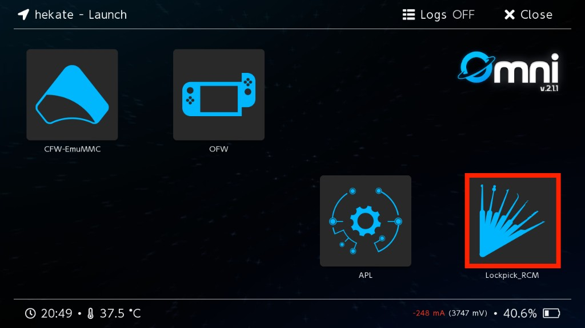
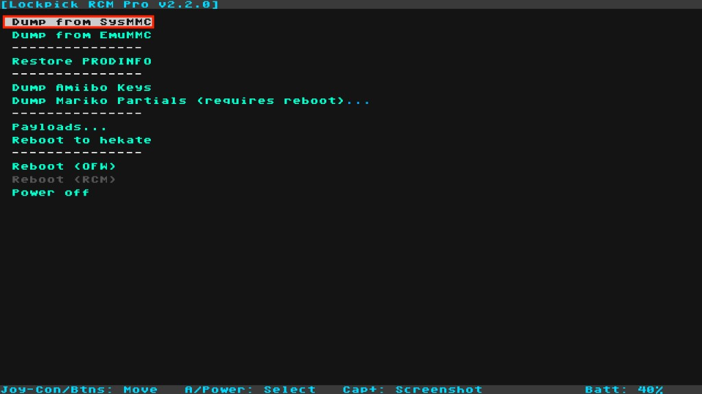
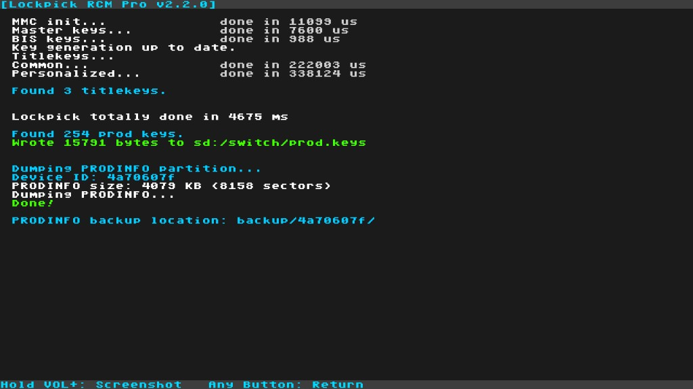
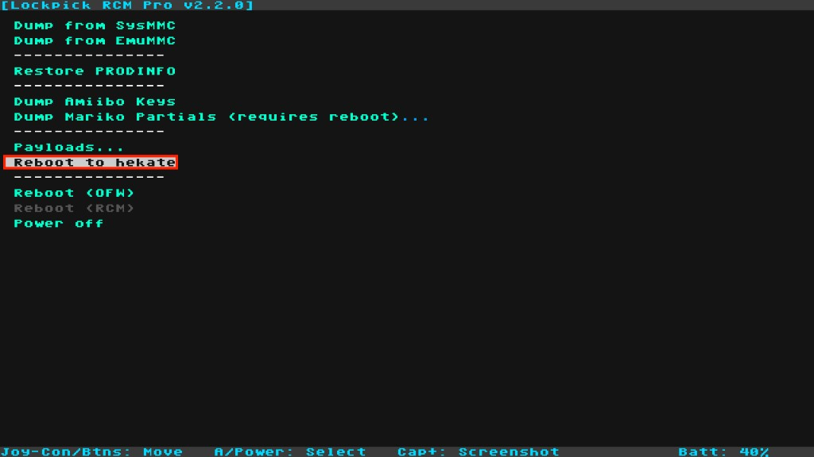

# prod.keys dumpen mit Lockpick RCM Pro

Falls du noch keine **prod.keys** hast, dumpe sie in Hekate mit **Lockpick RCM Pro**. Ab **OmniNX 2.1.1** startet der Launch-Eintrag **Lockpick_RCM** diese Version ([Lockpick RCM Pro](https://github.com/sthetix/Lockpick_RCM_Pro)).

!!!info Navigation
Unten in der Leiste steht die Bedienung:

- **Joy-Con/Btns: Move** – hoch und runter mit dem linken Joy-Con oder mit **Vol+ / Vol−**
- **A/Power: Select** – auswählen mit **A** oder der **Power-Taste**
- **Cap+: Screenshot** – **Vol+ halten** speichert einen Screenshot unter `switch/screenshot/`

An der **Switch Lite** funktionieren zur Navigation nur **Power** und **Vol+ / Vol−**.

Nach dem Dump wechselt die Leiste auf **Hold VOL+: Screenshot** und **Any Button: Return**. **Vol+ halten** macht den Screenshot, jede andere Taste geht zurück ins Menü.
!!!

---

## Keys dumpen

>>> Lockpick RCM starten
In **Hekate** unter **Launch** den Eintrag **Lockpick_RCM** auswählen.

>>> Dump from SysMMC
**Dump from SysMMC** ist markiert. Mit **A** oder **Power** starten und warten, bis der Lauf durch ist. Die Konsole dabei nicht ausschalten.

>>> Dump abwarten
Fertig ist der Lauf, wenn **Lockpick totally done in … ms** erscheint, danach **Found … prod keys.** und **Wrote … bytes to sd:/switch/prod.keys**. Darunter läuft der PRODINFO-Dump bis **Done!** und **PRODINFO backup location: backup/…/**.

Unten steht **Hold VOL+: Screenshot** und **Any Button: Return**.

>>> Zurück nach Hekate
**Reboot to hekate** auswählen und mit **A** oder **Power** bestätigen.

>>>

!!!success Fertig
Auf der SD liegen:

- `switch/prod.keys`
- `switch/title.keys`, wenn Titlekeys gefunden wurden
- `backup/<Geräte-ID>/` mit der PRODINFO

Installer und Tools erwarten `prod.keys` unter `switch/`.
!!!

!!!danger PRODINFO zusätzlich auf den PC kopieren
PRODINFO enthält Kalibrierungsdaten und Zertifikate dieser Konsole. Die Daten lassen sich nicht neu erzeugen. Kopiere den Ordner `backup/<Geräte-ID>/` vollständig auf den PC. Der Ordnername ist die **Device ID** aus dem Dump.

Im Ordner liegen `partitions/PRODINFO` (Hekate-Format) sowie `dumps/prodinfo.enc` und `dumps/prodinfo.dec`. Ein Backup nur auf der microSD schützt nicht vor Kartenausfall oder versehentlichem Löschen.
!!!
