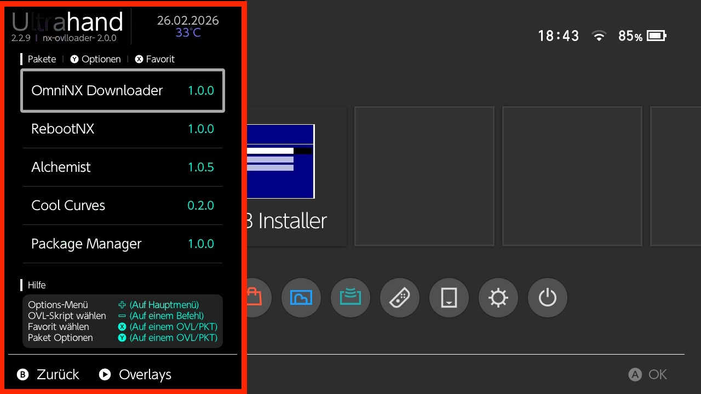
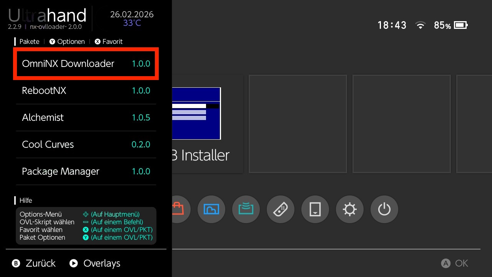
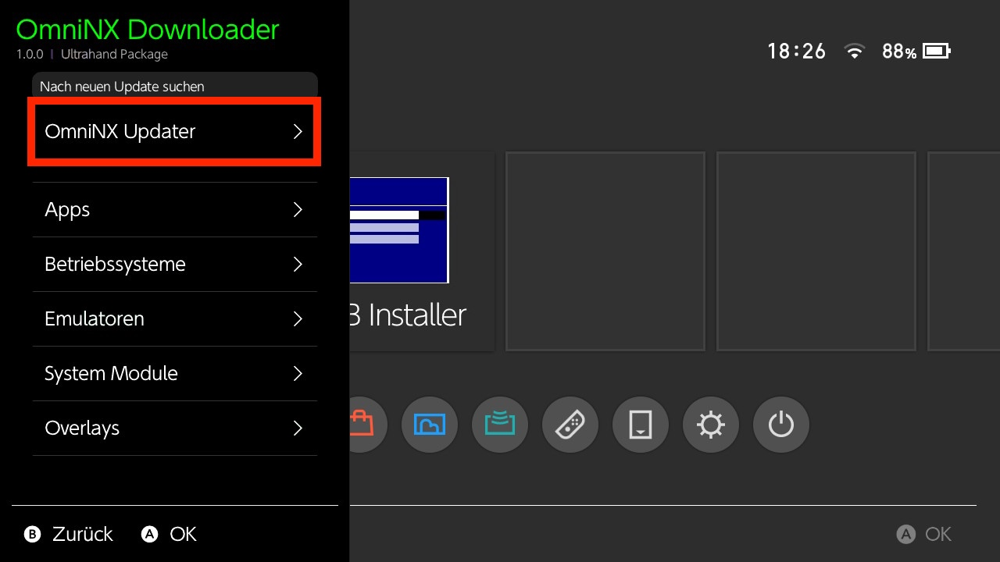
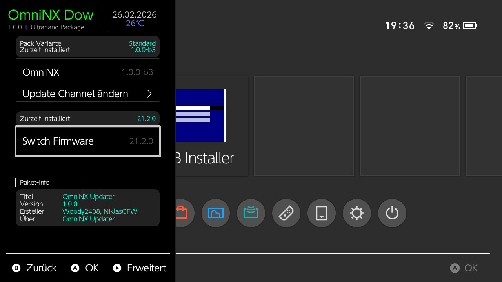
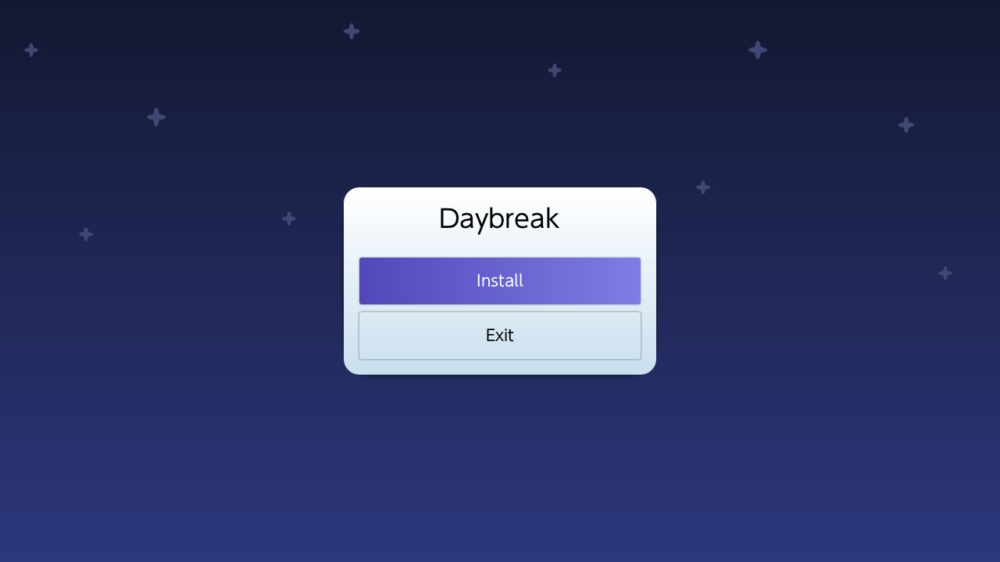
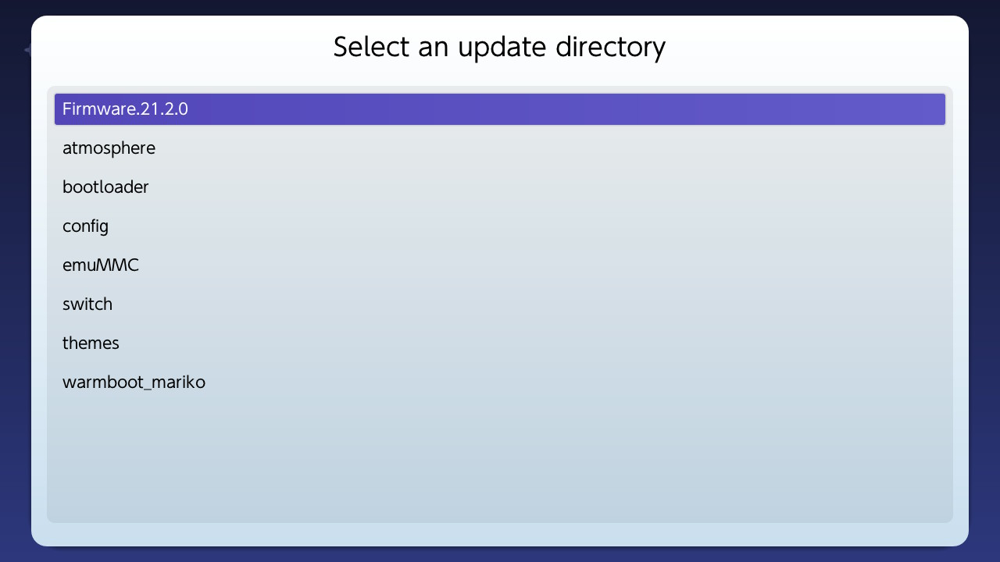
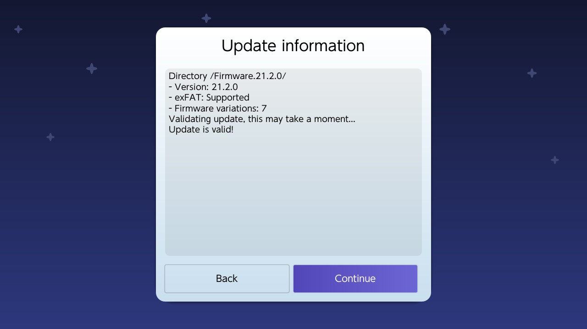
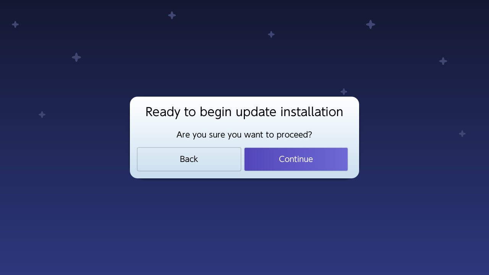
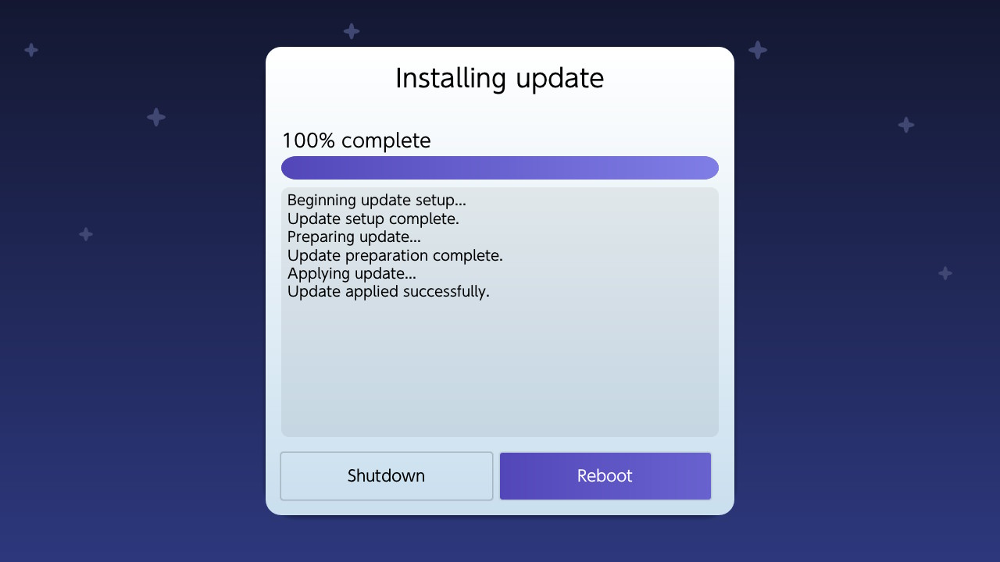

# Firmware updaten

Hier geht es um das **Aktualisieren** der **Switch-Firmware** (Horizon OS) in der CFW/emuMMC mit **Daybreak**.

!!!danger Themes vorher deinstallieren
Installierte **Custom Themes müssen vor dem Firmware-Update zwingend deinstalliert** werden. Sonst stößt du nach dem Update oft auf einen Fehler (typisch: **0100000000000001000**).
!!!

[!ref text="Custom Theme Fehler beheben"](/switch/fehlerbehebung/theme-visual/0100000000000001000_beheben_(custom_theme))

!!!warning Reihenfolge beachten: erst CFW, dann OFW
1. **OmniNX** aktualisieren ([OmniNX-Pack updaten](/switch/updates/omninx-update))
2. **CFW (emuMMC)** auf die neue Firmware aktualisieren (diese Seite)
3. **Erst danach die OFW (sysNAND)** aktualisieren ([siehe unten](#ofw-sysnand-updaten))

Aktualisierst du zuerst die OFW, kann es passieren, dass deine CFW danach nicht mehr startet, weil OmniNX bzw. Atmosphère die neue Firmware noch nicht unterstützt.
!!!

---

## Voraussetzungen

!!!warning Uhrzeit
Die **Uhrzeit** sollte synchronisiert sein (z. B. für Downloads). Anleitung: [Einrichtung](/switch/vorbereitung/pack_einrichten/#systemzeit-synchronisieren).
!!!

---

## Firmware der CFW (emuMMC) updaten

!!!info Firmware-Update
Die **neueste Firmware** ist nicht immer nötig. Spätestens wenn ein **Spiel** ein Update verlangt, kannst du aktualisieren. Sollte eine Firmware nicht empfohlen sein, wird das bekannt gegeben.
!!!

### Firmware herunterladen (UltraHand / OmniNX Updater)

>>> UltraHand öffnen
**UltraHand** öffnen (**L** + **R** + **Plus**).

>>> OmniNX Downloader starten
**OmniNX Downloader** in der Paketliste auswählen (**A**).

>>> OmniNX Updater → Firmware herunterladen
**OmniNX Updater** auswählen, darin die **Firmware**-Option (z. B. gewünschte Version) wählen und warten, bis der Download abgeschlossen ist.

>>>

---

### Firmware installieren (Daybreak)

1. **UltraHand** schließen, **Sphaira** starten.
2. **Daybreak** öffnen.

3. **Install** wählen.
4. **Firmware-Verzeichnis** wählen (z. B. **Firmware.21.0.1**).

5. Daybreak prüft die Firmware (**Update is valid!**).
6. **Continue** → **Preserve Settings**.
7. **Install (FAT32 + exFAT)** wählen.
8. **Continue** bestätigen (**Ready to begin update installation**).
9. Installation abwarten (100 %), dann **Reboot**.

10. Nach dem Neustart ist die neue Firmware aktiv.

---

## OFW (sysNAND) updaten

Die **OFW** aktualisierst du **erst, wenn die CFW (emuMMC) auf der neuen Firmware läuft** und alles funktioniert.

1. Konsole in die **OFW (sysNAND)** starten.
2. **Systemeinstellungen → System → Systemaktualisierung** wählen und das Update installieren.

!!!info Ist das OFW-Update nötig?
Nein. Die OFW muss nicht auf dem gleichen Stand wie die CFW sein. Aktualisiere sie nur, wenn du sie wirklich brauchst (z. B. für Online-Spiele in der OFW).
!!!

---

!!!success Fertig
Firmware-Update ist abgeschlossen. Bei Problemen: [Fehlerbehebung](/switch/fehlerbehebung/system-boot/hekate_fix_archive_bits).
!!!
